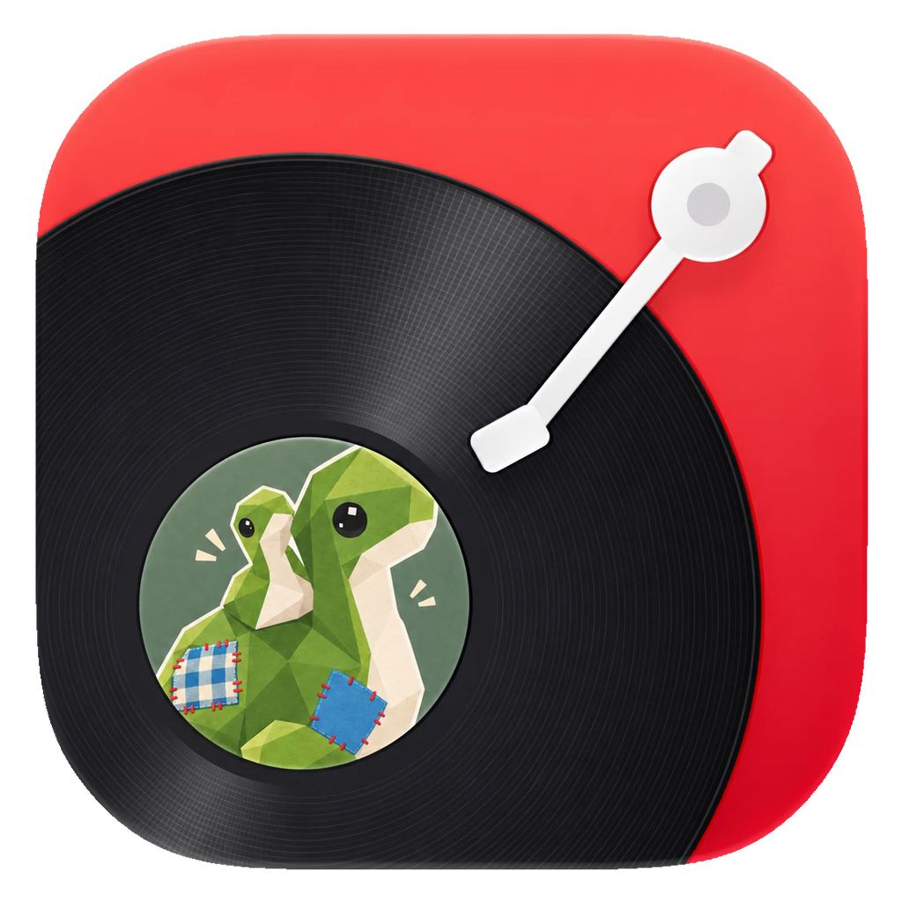

# Cloud-nya



nya 维护的第三方网易云音乐桌面客户端，基于 [egoist/mygo-cloudmusic](https://github.com/egoist/mygo-cloudmusic) 修改。用 Go 和 [MyGo](https://github.com/egoist/mygo) 编写，原生界面，无 WebView。

## 这个 fork 改了什么

- 液态玻璃胶囊播放栏，透明度和折射可调，封面像黑胶一样缓慢旋转
- 播放页微光：唱到的歌词、进度条和音量带柔和的光
- 全局 UI 统一：黑玻璃菜单、玻璃设置面板，圆角收成 4 档，侧栏带封面色调
- 完整的动画：播放页从播放栏展开，封面在卡片和详情之间飞入飞回，页面、弹层和列表都有过渡
- 歌单页改版：封面氛围背景、吸顶页头、列表内搜索与排序、封面堆叠
- 桌面歌词：透明悬浮，逐字点亮，五种样式，可拖动、调字号和锁定
- 迷你窗口：置顶的小窗播放器，可以拖进度、调音量，和主窗口之间有展开收起动画
- 风格漫游：42 种心情、场景、语种和曲风，不登录也能听
- 全局快捷键、定时关闭、按歌曲校准歌词时间、调节歌词字号
- 多种中文字体，列表里直接预览
- 设置里可以直接发送反馈

所有动画和玻璃效果都能在 设置 → 视觉效果 里调低或关闭。

## 下载

到 [Releases](https://github.com/nya-owo/mygo-nya/releases) 下载。安装包没有代码签名，Windows 可能提示“已保护你的电脑”，点“更多信息”后选“仍要运行”。

## 原项目的功能

- 扫码登录，登录态保存在系统凭据存储中
- 每日推荐、推荐歌单、排行榜、我的歌单
- 搜索单曲、歌手、专辑、用户与播客，输入时显示搜索建议，保留搜索历史
- 歌手页的热门与最新歌曲、专辑与动态，关注歌手；专辑页与用户页
- 播客：浏览与收听节目，订阅播客；在本机把节目转写成字幕（Qwen3-ASR），像歌词一样随播放滚动
- 私人 FM（推荐 / 熟悉 / 探索）与心动模式
- 边下边播，支持标准 / 较高 / 极高 / 无损（FLAC）/ Hi-Res 音质
- 听过的歌曲缓存在本机，再次播放无需等待
- 音量均衡，暂停与继续时淡出淡入，拖动进度无杂音
- 退出后再打开，从上次的播放队列与进度继续
- 逐字歌词与翻译，正在播放页的「律动」视图与歌曲评论
- 刘海播放器：在屏幕顶部刘海处显示迷你播放器，悬停展开（在设置中开启）
- 喜欢歌曲、播放队列、随机与循环播放
- 浅色 / 深色 / 跟随系统

## 构建

需要 Go 1.27+。

```bash
go tool mygo dev     # 开发模式运行
go tool mygo build   # 打包到 build/
go test ./...        # 运行测试
```

## 致谢

- [egoist/mygo-cloudmusic](https://github.com/egoist/mygo-cloudmusic)：本项目修改自它，原作者 egoist
- [Lucide](https://lucide.dev)：部分图标（ISC 许可）
- [MyGo](https://github.com/egoist/mygo)：原生 UI 与应用框架
- [NeteaseCloudMusicApi](https://github.com/Binaryify/NeteaseCloudMusicApi)：eapi 加密与登录流程的参考
- [folia-major](https://github.com/chthollyphile/folia-major)：歌词动画效果的参考
- [sherpa-onnx](https://github.com/k2-fsa/sherpa-onnx)、[Qwen3-ASR](https://github.com/QwenLM/Qwen3-ASR) 与 [Silero VAD](https://github.com/snakers4/silero-vad)：本机语音识别

本项目与网易云音乐官方无关，音乐版权归各权利人所有。

## 许可证

[AGPL-3.0](LICENSE)
